# Kustomize on Kind — Step-by-Step Guide

This folder contains everything the practical expects:

```
dso202-practical-05/
├── README.md
├── GUIDE.md                 ← this file
├── evidence/                ← screenshots / saved outputs for the report
└── examples/webapp/
    ├── base/                ← deployment.yaml, service.yaml, index.html, kustomization.yaml
    └── overlays/
        ├── dev/             ← 1 replica,  webapp-dev
        ├── staging/         ← 2 replicas, webapp-staging, annotation patch (strategic merge)
        ├── prod/            ← 3 replicas, webapp-prod, patch-resources.yaml, image nginx:1.27
        ├── qa/              ← you create this in Task 9 (JSON 6902 patch)
        └── sandbox/         ← Challenge (namePrefix)
```

> **Cluster:** this lab uses the existing Kind cluster **`dso202`** (context `kind-dso202`: `control-plane`, `worker-node-1`, `worker-node-2`). No new cluster is created.
>
> **Task 9:** the `qa/` overlay is not included — you create it yourself in Task 9.

Take a screenshot of every command's output as you go — the report needs it.

---

## Step 0 — Set up

Requirements: Docker running, `kind`, `kubectl` (v1.21+ has Kustomize built in), `tree`, `curl`.

Use the existing `dso202` cluster — do **not** create a new one. Confirm it is running and selected:

```bash
cd dso202-practical-05
kind get clusters                    
kubectl config current-context       
```
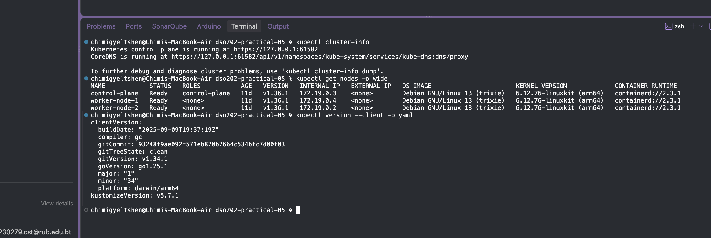

If the context is different, switch to it:

```bash
kubectl config use-context kind-dso202
```
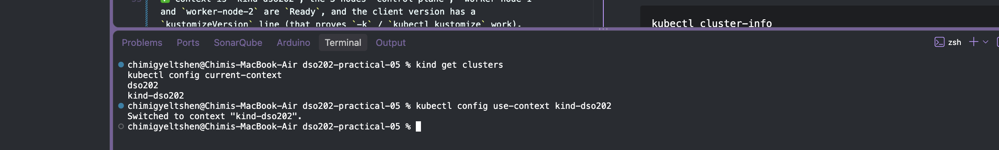

## Task 0 — Pre-flight

```bash
kubectl cluster-info
kubectl get nodes -o wide
kubectl version --client -o yaml
```
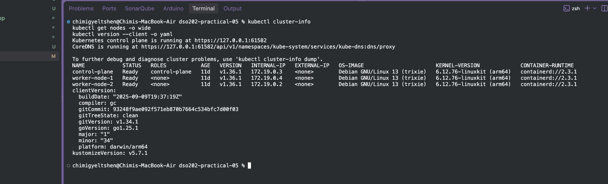

✅ Context is `kind-dso202`, the 3 nodes `control-plane`, `worker-node-1` and `worker-node-2` are `Ready`, and the client version has a `kustomizeVersion` line (that proves `-k` / `kubectl kustomize` work).

## Task 1 — Read the repository

```bash
tree examples/webapp
cat examples/webapp/base/kustomization.yaml
cat examples/webapp/overlays/dev/kustomization.yaml
```
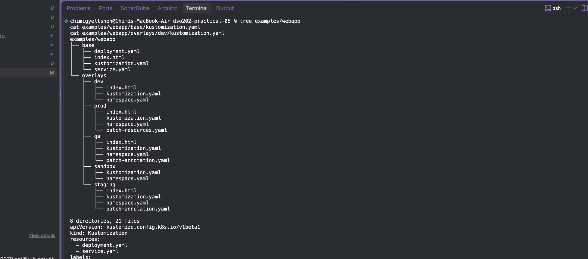


Answers:

1. **Files that exist only once:** `base/deployment.yaml` and `base/service.yaml` (and the base `kustomization.yaml`). No overlay copies them.
2. **Values that differ:** namespace, `environment` label, replica count (1/2/3), image tag (prod uses `nginx:1.27`), the page content (`index.html`), CPU/memory resources (prod), owner annotation (staging/prod).
3. **Where:** in each overlay's `kustomization.yaml` (`namespace`, `labels`, `replicas`, `images`, `configMapGenerator`) and in the overlay's patch files (`patch-resources.yaml`, `patch-annotation.yaml`).

## Task 2 — Render the base (don't apply)

```bash
kubectl kustomize examples/webapp/base
kubectl kustomize examples/webapp/base | grep '^kind:'
kubectl kustomize examples/webapp/base | grep 'name: web-content'
```
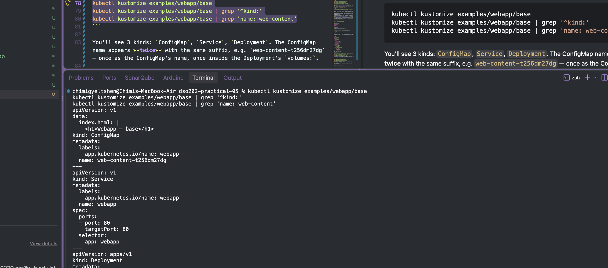

You'll see 3 kinds: `ConfigMap`, `Service`, `Deployment`. The ConfigMap name appears **twice** with the same suffix, e.g. `web-content-t256dm27dg` — once as the ConfigMap's name, once inside the Deployment's `volumes:`.

**Checkpoint answer:** `configMapGenerator` adds a hash of the ConfigMap's *content* to its name. When the content changes, the name changes, and Kustomize rewrites every reference (the Deployment volume) to the new name. That forces a rollout so pods never keep serving stale config. A plain fixed name `web-content` would update silently without restarting pods.

## Task 3 — Compare dev and prod (no cluster changes)

```bash
kubectl kustomize examples/webapp/overlays/dev  > /tmp/webapp-dev.yaml
kubectl kustomize examples/webapp/overlays/prod > /tmp/webapp-prod.yaml
diff -u /tmp/webapp-dev.yaml /tmp/webapp-prod.yaml || true
```
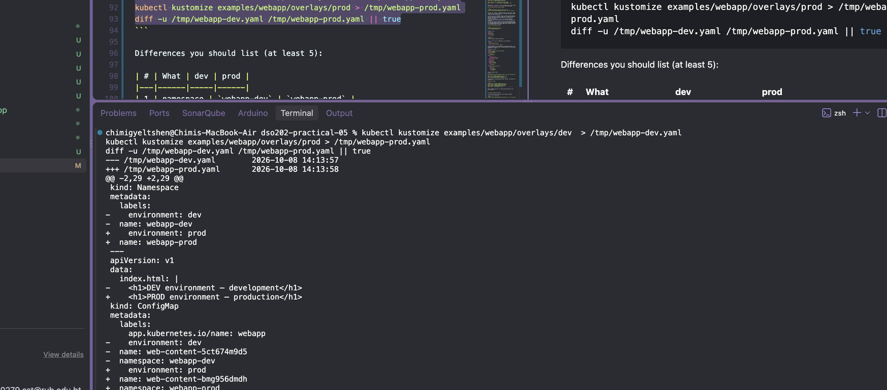

Differences you should list (at least 5):

| # | What | dev | prod |
|---|------|-----|------|
| 1 | namespace | `webapp-dev` | `webapp-prod` |
| 2 | `environment` label | `dev` | `prod` |
| 3 | replicas | 1 | 3 |
| 4 | image | `nginx:1.27-alpine` | `nginx:1.27` |
| 5 | resources | requests 50m/32Mi, limit 64Mi | requests 100m/64Mi, limit 128Mi |
| 6 | page content + ConfigMap hash | DEV text, one hash | PROD text, different hash |
| 7 | annotation | none | `training.example.com/owner: platform-team` |

## Task 4 — Deploy dev safely

```bash
kubectl kustomize examples/webapp/overlays/dev         
kubectl diff -k examples/webapp/overlays/dev || true    
kubectl apply -k examples/webapp/overlays/dev          
kubectl get all -n webapp-dev                           
kubectl get configmap -n webapp-dev
kubectl rollout status deployment/webapp -n webapp-dev
```
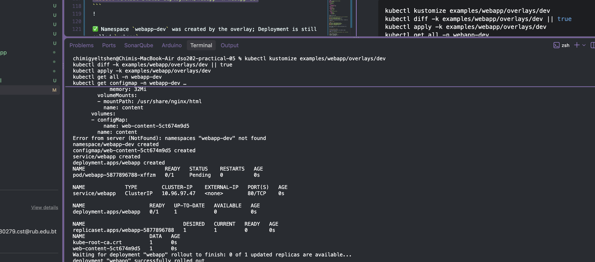

✅ Namespace `webapp-dev` was created by the overlay; Deployment is still called `webapp`.

## Task 5 — Reach the app

Terminal 1:
```bash
kubectl port-forward -n webapp-dev service/webapp 8080:80
```
Terminal 2:
```bash
curl http://127.0.0.1:8080
```
✅ Output: `<h1>DEV environment — development</h1>`. Press Ctrl+C in terminal 1 to stop.
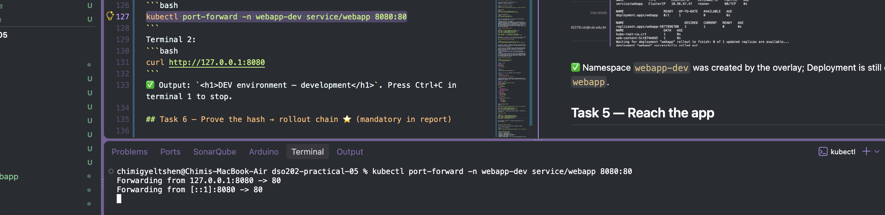


## Task 6 — Prove the hash → rollout chain ⭐ (mandatory in report)

**Before** (screenshot both):
```bash
kubectl get configmap -n webapp-dev
kubectl get pods -n webapp-dev -o wide
```
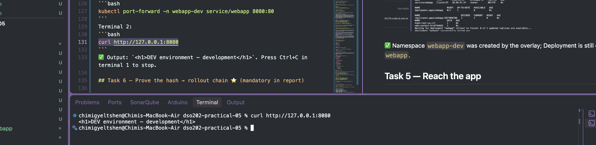


Edit `examples/webapp/overlays/dev/index.html` to:
```html
<h1>DEV v2 — configuration changed</h1>
```

Render first — note the **new** hash:
```bash
kubectl kustomize examples/webapp/overlays/dev | grep 'name: web-content'
```
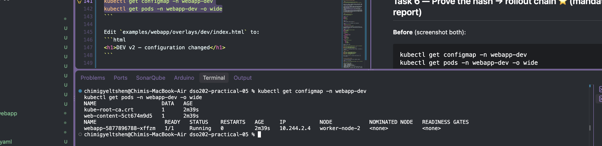

Apply and watch:
```bash
kubectl apply -k examples/webapp/overlays/dev
kubectl rollout status deployment/webapp -n webapp-dev
```
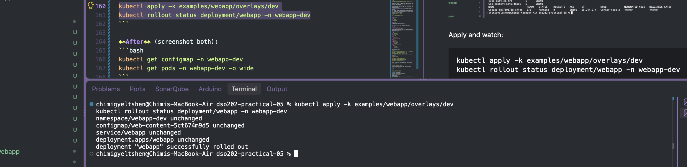

**After** (screenshot both):
```bash
kubectl get configmap -n webapp-dev
kubectl get pods -n webapp-dev -o wide
```
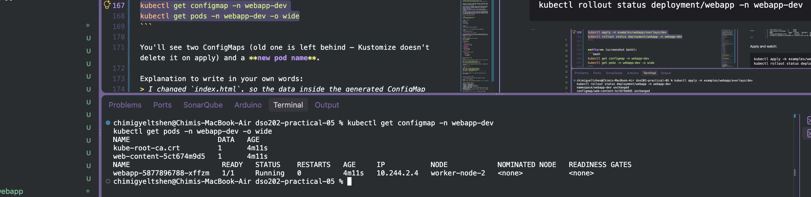

You'll see two ConfigMaps (old one is left behind — Kustomize doesn't delete it on apply) and a **new pod name**.

Explanation to write in your own words:
> I changed `index.html`, so the data inside the generated ConfigMap changed. Kustomize hashes the ConfigMap content into its name, so the name changed from `web-content-<old>` to `web-content-<new>`. Kustomize also rewrote the Deployment's volume to reference the new name. That reference sits inside the pod template, so the pod template changed, and any pod-template change makes the Deployment roll out new pods (new pod names) that mount the new content.

## Task 7 — Deploy staging and prod

```bash
kubectl diff -k examples/webapp/overlays/staging || true
kubectl apply -k examples/webapp/overlays/staging
kubectl diff -k examples/webapp/overlays/prod || true
kubectl apply -k examples/webapp/overlays/prod

kubectl get deploy -A -l app.kubernetes.io/name=webapp
kubectl get pods   -A -l app.kubernetes.io/name=webapp -o wide
```
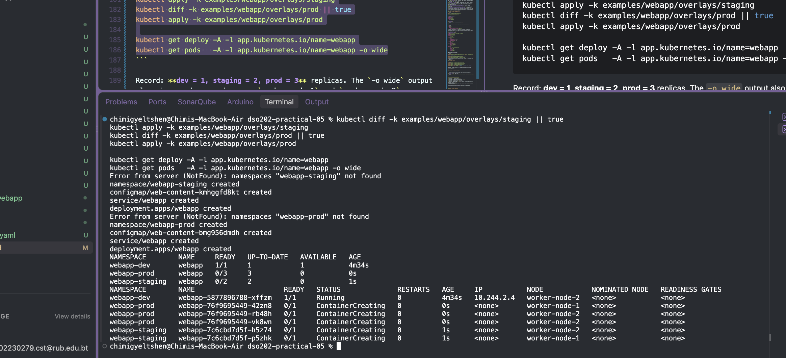

Record: **dev = 1, staging = 2, prod = 3** replicas. The `-o wide` output also shows pods spread across `worker-node-1` and `worker-node-2`.

## Task 8 — What did the prod patch change?

```bash
cat examples/webapp/overlays/prod/patch-resources.yaml
kubectl kustomize examples/webapp/overlays/prod | grep -A8 'resources:'
```
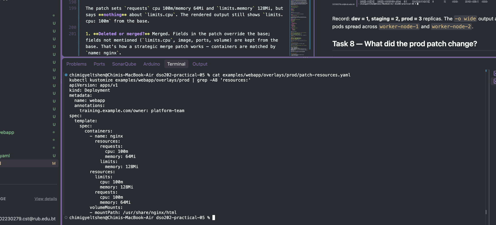
The patch sets `requests` cpu 100m/memory 64Mi and `limits.memory` 128Mi, but says **nothing** about `limits.cpu`. The rendered output still shows `limits.cpu: 100m` from the base.

1. **Deleted or merged?** Merged. Fields in the patch override the base; fields not mentioned (`limits.cpu`, image, ports, volume) are kept from the base. That's how a strategic merge patch works — containers are matched by `name: nginx`.
2. **Who owns the production resource policy?** The prod overlay (`overlays/prod/patch-resources.yaml`). Base and other environments are unaffected.
3. **Why patch instead of copying `deployment.yaml`?** The patch is ~15 lines that show only what's different. A copy would duplicate everything, so a later base change (new port, new image, security setting) would have to be repeated by hand and prod would silently drift. Reviewers can also see the prod difference at a glance.

## Task 9 — Create the QA overlay

```bash
mkdir -p examples/webapp/overlays/qa
cd examples/webapp/overlays/qa
```
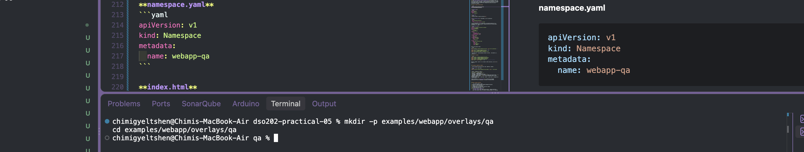

**namespace.yaml**
```yaml
apiVersion: v1
kind: Namespace
metadata:
  name: webapp-qa
```

**index.html**
```html
<h1>QA environment — quality assurance</h1>
```

**patch-annotation.yaml** — JSON 6902 (a list of operations)
```yaml
- op: add
  path: /metadata/annotations
  value:
    training.example.com/owner: qa-team
```
(The base Deployment has no annotations, so we add the whole map. If it already had some, you'd use `path: /metadata/annotations/training.example.com~1owner` — `~1` means `/`.)

**kustomization.yaml**
```yaml
apiVersion: kustomize.config.k8s.io/v1beta1
kind: Kustomization
namespace: webapp-qa
resources:
  - ../../base
  - namespace.yaml
labels:
  - pairs:
      environment: qa
    includeSelectors: false
    includeTemplates: true
replicas:
  - name: webapp
    count: 2
configMapGenerator:
  - name: web-content
    behavior: replace
    files:
      - index.html
patches:
  - path: patch-annotation.yaml
    target:
      group: apps
      version: v1
      kind: Deployment
      name: webapp
```

Back in the project folder:
```bash
cd ../../../..
kubectl kustomize examples/webapp/overlays/qa | grep -B1 -A2 annotations   
kubectl diff -k examples/webapp/overlays/qa || true
kubectl apply -k examples/webapp/overlays/qa
kubectl get deployment webapp -n webapp-qa -o yaml
```
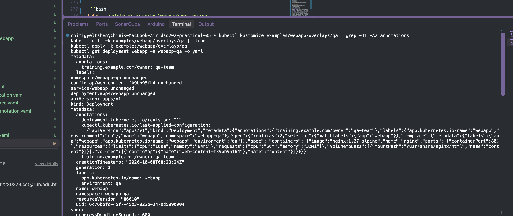


✅ The YAML shows `training.example.com/owner: qa-team`, `environment: qa`, `replicas: 2`.

## Task 10 — Cleanup

```bash
kubectl delete -k examples/webapp/overlays/dev
kubectl delete -k examples/webapp/overlays/staging
kubectl delete -k examples/webapp/overlays/prod
kubectl delete -k examples/webapp/overlays/qa
kubectl get ns | grep 'webapp-' || true   
```
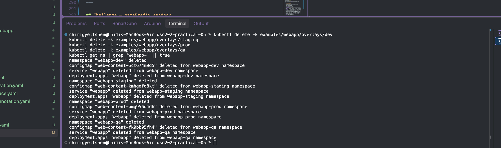

Keep the `dso202` cluster — it is reused in other practicals, so do **not** delete it.

---

## Challenge — namePrefix sandbox

`overlays/sandbox/kustomization.yaml` adds `namePrefix: sandbox-`.

**Predict first**, then check:
```bash
kubectl kustomize examples/webapp/overlays/sandbox | grep -E '^kind:|name:'
```
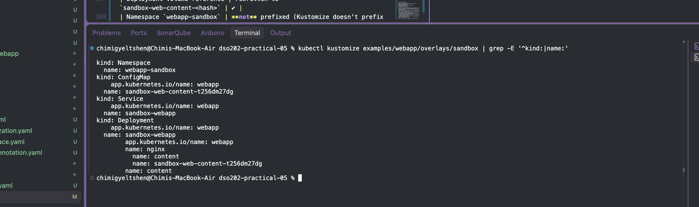

| Object | Prediction | Result |
|--------|-----------|--------|
| Deployment | `sandbox-webapp` | ✔ |
| Service | `sandbox-webapp` | ✔ |
| ConfigMap | `sandbox-web-content-<hash>` | ✔ |
| Deployment volume reference | rewritten to `sandbox-web-content-<hash>` | ✔ |
| Namespace `webapp-sandbox` | **not** prefixed (Kustomize doesn't prefix Namespace objects) | ✔ |
| Container name `nginx`, volume name `content`, label values | unchanged (not resource names) | ✔ |

Lesson: Kustomize is **reference-aware** — renaming the ConfigMap automatically fixes the Deployment's reference, so nothing breaks.

---

## Report evidence checklist

1. `tree examples/webapp` output
2. Excerpt of `kubectl kustomize examples/webapp/overlays/dev`
3. Excerpt of the dev/prod `diff -u`
4. `kubectl get all -n webapp-dev`
5. ConfigMap names before and after the Task 6 change
6. Pod names before and after rollout
7. Your four QA overlay files
8. **Strategic merge vs JSON 6902:**
   - *Strategic merge* (prod `patch-resources.yaml`, staging annotation): looks like a partial copy of the object; Kustomize merges it in, matching list items such as containers by name. Easy to read; best for changing/adding fields.
   - *JSON 6902* (QA `patch-annotation.yaml`): a list of exact operations (`add`, `replace`, `remove`, `move`, `copy`, `test`) at exact paths. More precise — can remove fields or target a specific list index — but paths must exist and are less readable.
9. **Reflection** — write about a real mistake you hit. Common ones:
   - the annotation didn't appear because the JSON 6902 `path` was wrong, or the patch `target` didn't match the Deployment;
   - forgetting `behavior: replace` on the overlay's `configMapGenerator` → error that `web-content` already exists;
   - expecting a fixed name `web-content` in `kubectl get configmap` and seeing the hashed name instead.
   Explain how rendering (`kubectl kustomize ...`) showed the problem *before* anything reached the cluster.

Remember: keep the same report structure as your previous practicals.